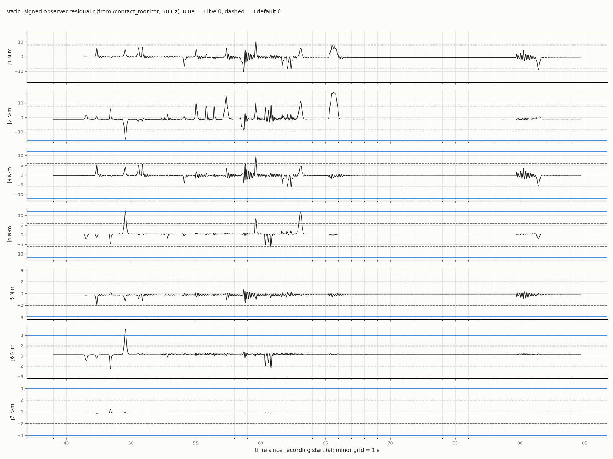
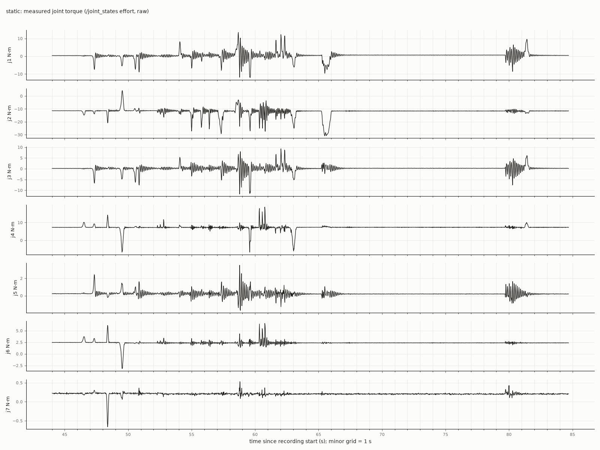
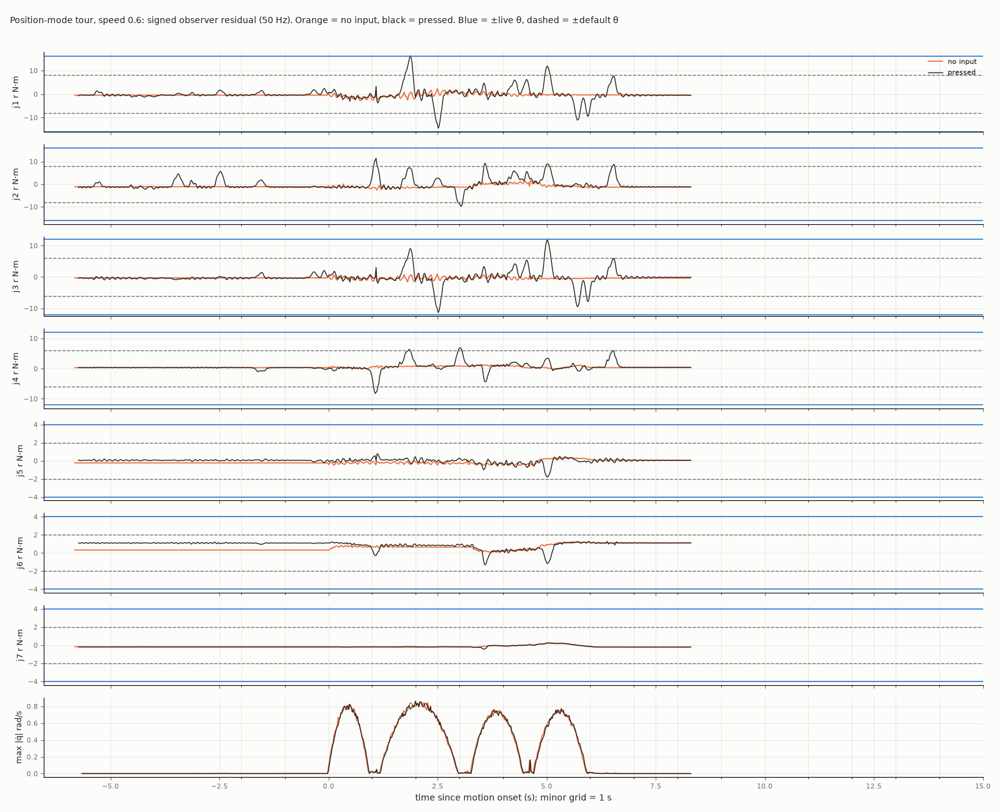

# Contact detection — bump resolution on the arm (2026-10-30)

How the momentum-observer residual `r` responds to hand taps, with the arm still and
with it moving. Recorded on the dojo arm (abra), running the `contact-detection` test
image (nightly plus this branch) in `observe` mode. The monitor ran
at 1 kHz and counted would-be trips without stopping the arm.

- Live thresholds: `[16,16,12,12,4,4,4]` N·m, set through `/set_contact_thresholds`
  (about double the starting defaults `[8,8,6,6,2,2,2]`).
- Data: `/contact_monitor` (residual sampled at 50 Hz, `would_trips` counted at
  1 kHz) and `/joint_states`.
- Position mode throughout: a position hold at home for the still run, and the tour
  at speed 0.6 for the moving runs.

## Still, position hold at home

The first 44 s had nobody touching the arm. Taps on the gripper and forearm followed,
at varying force and direction.

| N·m | j1 | j2 | j3 | j4 | j5 | j6 | j7 |
|---|---|---|---|---|---|---|---|
| rest offset | −0.36 | −1.28 | −0.26 | +0.33 | −0.23 | +0.24 | −0.22 |
| σ | 0.008 | 0.009 | 0.006 | 0.009 | 0.002 | 0.004 | 0.002 |
| peak \|r\| | 0.39 | 1.32 | 0.31 | 0.37 | 0.24 | 0.25 | 0.23 |

Blue lines are ±live θ, dashed lines ±default θ. The 1 kHz counter logged 4 would-be
trips at the live thresholds: 49.5 s (j4 12.5, j6 5.3 N·m), 63.1 s (j4 about 12) and
65.5 s (j2 17). Several more taps cross the default thresholds. The stretches at
58–61 s and 79–81 s ring at about 5 Hz. That looks like the position hold
oscillating after a tap, not separate taps.

The raw torque sensors over the same window, for comparison.

Smallest force at the gripper (`arm_end_effector_link`, home pose) that takes some
`|r_i|` past `θ_i`, including the rest offsets. The last column is the force that
moves `r` 6σ off rest, which is the floor set by sensor noise.

| direction | live θ | default θ | 6σ |
|---|---|---|---|
| ±x | 45–48 N (j4) | 22–25 N (j4) | 0.2 N |
| ±y | 28–29 N (j3, j5) | 13–14 N (j3, j5) | 0.1 N |
| ±z | 23–25 N (j6) | 11–13 N (j6) | 0.1 N |

The default-θ column matches the earlier push test, where a downward push of about
11 N on the gripper tripped j6.

## Moving, position-mode tour at speed 0.6

One loop with nobody touching, then the same loop with presses during the motion.
The two runs are aligned at motion onset, and their joint speeds overlay.

| peak \|r\| over the move, N·m | j1 | j2 | j3 | j4 | j5 | j6 | j7 |
|---|---|---|---|---|---|---|---|
| no input | 2.9 | 2.6 | 1.6 | 1.4 | 0.6 | 1.2 | 0.3 |
| pressed | 16.3 | 11.5 | 11.8 | 8.3 | 1.8 | 1.3 | 0.5 |

- **Motion floor.** Motion raises the floor to about 3 N·m on j1 and j2, against 0.4
  and 1.3 still. It follows the accelerations, as in the earlier tours.
- **Presses.** They reach 6–16 N·m on j1–j3, well clear of the motion floor. Several
  cross the default thresholds.
- **Live thresholds.** The 1 kHz counter logged none. The closest was j1 at 1.9 s:
  one 50 Hz sample at 16.32 against θ = 16, over for roughly 10–15 ms by
  interpolation. The debounce needs 5 consecutive 1 kHz samples over θ. A residual
  that dips back under inside that window does not count. Nothing records the 1 kHz
  residual, so this could not be confirmed.

## What this says

- **Still, the observer resolves taps far below any threshold in use.** The noise
  floor is about 0.1–0.2 N at the gripper, so the threshold sets the sensitivity.
- **In motion, model error is the floor, not the sensor.** It is about 3 N·m on the
  proximal joints in position mode at 0.6, and it varies slowly with the motion.
  A held object behaves the same way, as a slow offset. The fast part of a tap stands
  well above both. Separating the two is tracked in
  [#111](https://github.com/rammp-org/kinova-gen3-driver/issues/111). For now
  the detector stays a plain threshold on `|r|`.
